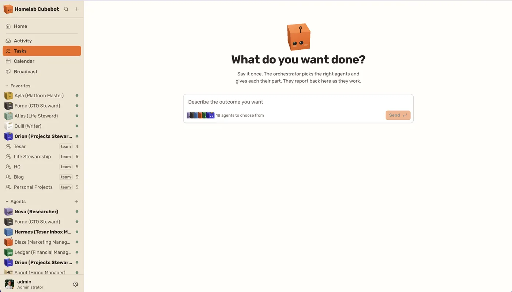

# Cubebot

**Persistent AI agents on infrastructure you control.**

Cubebot is a self-hosted platform for a team of AI agents that live with you. Each agent has its own name, memory, workspace and computer. You work with them in a web console and installable app that feels like a chat workspace. Agents keep what they learn across restarts and upgrades, and they only reach the tools, accounts and data you grant them.

<p align="center">
  
</p>
<p align="center"><sub>Tasks · Home · Chat · Desktop · Calendar · Skills · Platform</sub></p>

## What you get

- **Agents that last.** One permanent conversation, one memory and one workspace per agent, kept across restarts, upgrades and moves. Idle agents sleep, then "dream" to tidy their memory, and you can see what changed.
- **A computer for every agent.** Each agent runs in its own sandbox, a KVM virtual machine or a container, with a terminal, a browser and a desktop you can watch live.
- **Rooms, teams and tasks.** Talk to one agent, mention several in a room, or group them into teams with an org chart. Describe an outcome in Tasks and the orchestrator splits the work across the right agents.
- **Calendar and routines.** Schedule recurring work, see every agent's runs on one calendar, and layer in your own calendars.
- **Skills and a knowledge base.** Reusable procedures with revisions that any person or agent can publish, plus shared pages and files.
- **Any model.** Anthropic, OpenAI, Google Gemini, xAI Grok, OpenRouter and MiniMax, with a model per agent and spend tracked per agent. ChatGPT and SuperGrok plans can sign in instead of an API key.
- **Native connectors.** 34 of them, including GitHub, Google, Microsoft 365, Slack, Notion, Linear, Jira and Home Assistant, plus any MCP server.
- **Voice.** Call an agent from the console and talk.
- **You stay in control.** Grants per agent and connection, approvals for sensitive actions, an encrypted vault, an audit log, single sign-on with OpenID Connect, and backups to S3.

## Install

You need Linux or macOS with Docker (Compose 2.23 or later).

```sh
curl -fsSL https://cubebot.io/install.sh | bash
```

The installer asks four questions. Each has a sensible default, so pressing Enter four times works.

| Question          | Choices                                                                                                                                                                                                        |
| ----------------- | -------------------------------------------------------------------------------------------------------------------------------------------------------------------------------------------------------------- |
| Where agents run  | `kvm`: a virtual machine per agent, the strongest isolation (x86_64 Linux with `/dev/kvm`). `container`: a plain container per agent, a weaker boundary that runs anywhere, including macOS. `off`: no agents. |
| How you reach it  | This machine at <http://localhost:3000>, or your own domain on ports 80 and 443 with an automatic certificate. The domain must already point at this machine.                                                  |
| Install directory | `~/.cubebot` by default. Running the installer again updates it and keeps your settings.                                                                                                                       |
| Administrator     | Create it now in the terminal, or let the first person who opens the console claim it. With a public domain, create it now.                                                                                    |

Then open the address it prints, sign in, and add a model provider key under the gear beside your name, in **AI providers**. Create your first agent with the **+** beside **Agents**.

Manage the installation with the `cubebot` command:

```sh
~/.cubebot/cubebot up          # start
~/.cubebot/cubebot down        # stop, keeping your data
~/.cubebot/cubebot update      # move to the latest release, or name one: update v0.2.15
~/.cubebot/cubebot logs -f     # follow the logs
~/.cubebot/cubebot admin       # create the administrator if nobody has yet
~/.cubebot/cubebot uninstall   # remove everything this installation created, data included
```

> [!WARNING]
> The orchestrator starts agents through the host's Docker socket, which gives it root on that machine. Install Cubebot only where you would grant that.

<details>
<summary>Unattended installs</summary>

Every question has a variable, and a question whose variable is set is not asked:

| Variable                                                | Meaning                                       |
| ------------------------------------------------------- | --------------------------------------------- |
| `CUBEBOT_RUNTIME`                                       | `kvm`, `container` or `off`                   |
| `CUBEBOT_ACCESS`, `CUBEBOT_DOMAIN`                      | `local`, or `domain` with the domain to serve |
| `CUBEBOT_HOME`                                          | Install directory                             |
| `CUBEBOT_ADMIN`                                         | `now` or `console`                            |
| `CUBEBOT_BOOTSTRAP_LOGIN`, `CUBEBOT_BOOTSTRAP_PASSWORD` | The administrator, with `CUBEBOT_ADMIN=now`   |
| `CUBEBOT_PORT`                                          | Local port, 3000 by default                   |
| `CUBEBOT_VERSION`                                       | A release tag instead of the latest           |
| `CUBEBOT_YES=1`                                         | Take every default without asking             |
| `NO_COLOR`                                              | Plain output                                  |

</details>

### On Kubernetes

Each release publishes a Helm chart. One installation lives in one namespace, behind your ingress controller or Gateway:

```sh
kubectl create namespace cubebot
kubectl label namespace cubebot pod-security.kubernetes.io/enforce=baseline   # privileged for kvm
kubectl -n cubebot create secret generic cubebot-admin --from-literal=password="$(openssl rand -base64 24)"
helm install cubebot oci://ghcr.io/vicotrbb/charts/cubebot --namespace cubebot --values my-values.yaml
```

```yaml
# my-values.yaml
publicOrigin: https://cubebot.example.com
admin: { login: admin, existingSecret: cubebot-admin }
ingress: { host: cubebot.example.com, tlsSecret: cubebot-tls }
```

Agents run as containers by default. Set `sandbox.runtime: kvm` to give each agent a virtual machine, which needs nodes with `/dev/kvm`. [`deploy/README.md`](deploy/README.md) covers ingress, TLS, Argo CD and backups, and [`values.yaml`](deploy/chart/values.yaml) documents every setting.

## Develop

You need Rust through rustup, Bun 1.4.0, Node 24.18.0, uv 0.11.26, just 1.55.1, ShellCheck, and a C compiler. The repository pins Rust 1.96.0 and Python 3.14.6.

```sh
just bootstrap   # install the locked dependencies and the complexity checker
just check       # formatting, lint, complexity gate, tests and builds
just smoke       # start the built services, check them, stop them
```

Run the API and the console in two terminals, then open <http://localhost:3000>:

```sh
just dev-api
just dev-web
```

To run the whole platform from source as an installation would, use `just up` (and `just admin` to create the administrator); `just down` stops it and keeps your data. Building the `kvm` sandbox also needs `make`, `gcc`, `flex`, `bison`, `bc` and the libelf headers.

`just integration` runs the database, HTTP and OpenID Connect tests against a throwaway PostgreSQL. The [operator and API reference](docs/reference.md) covers configuration, the local database and container builds.

### Layout

| Path                | What lives there                                                      |
| ------------------- | --------------------------------------------------------------------- |
| `apps/orchestrator` | The control plane: identity, PostgreSQL, HTTP API and agent lifecycle |
| `apps/agent`        | The agent runtime, which runs its own tools inside its sandbox        |
| `apps/sandbox`      | `cubebot-sandbox`, the in-house KVM virtual machine monitor           |
| `apps/web`          | The console and installable app (TanStack Start)                      |
| `modules/`          | Shared contracts, model providers and connectors                      |
| `deploy/`           | The installer, Docker Compose files and the Helm chart                |
| `site/`             | The public website                                                    |
| `docs/adr/`         | Accepted product and architecture decisions                           |

## Learn more

- [Manifesto](MANIFESTO.md): why Cubebot exists
- [Architecture](ARCHITECTURE.md) and [decisions](docs/adr/README.md): how it fits together
- [Operator and API reference](docs/reference.md)
- [Contributing](CONTRIBUTING.md), [code of conduct](CODE_OF_CONDUCT.md) and [security policy](SECURITY.md)

Cubebot is licensed under [Apache-2.0](LICENSE).
