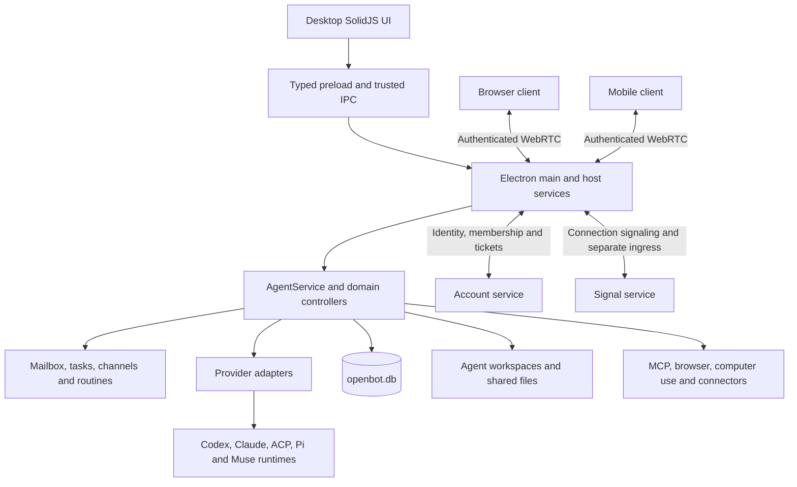
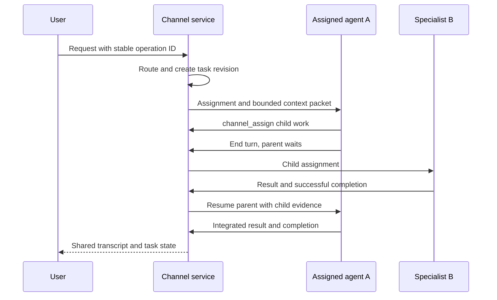

# OpenBot implementation reference

Research date: October 22, 2026. Repository: [nightly-labs/openbot](https://github.com/nightly-labs/openbot). Pinned revision: [`cfee2971f29cdb7c16272e60ae912de7fbb30693`](https://github.com/nightly-labs/openbot/commit/cfee2971f29cdb7c16272e60ae912de7fbb30693). The root package identifies itself as version `0.48.1`. This is the checked-out source version, not a claim about the newest binary on every distribution channel.

This reference combines source tracing, architecture documentation, contracts, schema inspection, and inspection of regression/E2E scripts. It does not claim every line was read or that all supported providers and platforms were run. No application was launched, dependencies installed, model turns purchased, cloud resources changed, or upstream code edited. The companion notes contain the detailed algorithms and pinned source citations.

## Reading map

| Reference | Detailed coverage |
| --- | --- |
| [Agent runtime and memory](openbot-agent-runtime-memory.md) | Agent creation, provider protocols, queues, steering, interruption, recovery, context, compaction, history, saved memory and provider-specific behavior |
| [Collaboration and channels](openbot-collaboration-channels.md) | Direct exchanges, fan-out/fan-in, room routing, task graphs, assignments, revisions, resource scheduling, summaries and channel memory |
| [Platform, tools and remote access](openbot-platform-tools-remote.md) | Team API, WebRTC, authentication, clients, MCP, skills, plugins, browser/computer use, shared SQL, sites, routines and ingress |
| [Source inventory](openbot-source-inventory.json) | Exact revision, workspace counts and test/script file inventory |

## What OpenBot is

OpenBot is a host application for persistent AI teammates. The host owns identities, workspaces, conversations, queues and tool access. External provider runtimes execute model turns. Desktop, web and mobile interfaces observe or control that host. Optional account services establish who may connect; they are not the authoritative conversation database. A host can run on a personal desktop or on a server. In this architecture, local means local to the executor. [Workspace structure][structure], [host composition][composition]

Its main implementation is a TypeScript/Bun workspace. The desktop packages Electron and uses SolidJS for the interface. Backend services increasingly use Effect for typed failures, workflows and resource lifetimes. SQLite is accessed through Node's `DatabaseSync`. The mobile application uses Expo/React Native. Cloud services include the account/public-web Worker, a static-site Worker, and a separate Bun Signal service. These are separate deployment and failure domains. [Package manifest][package], [database connection][dbcore], [workspace structure][structure]

The diagram separates execution from identity and transport. Messaging ingress is an additional content path through Signal. Published site assets go to R2. Provider requests, visited websites and connected tools also send data outside the host. Therefore host-owned chat storage does not mean the whole product is offline or that every feature keeps every byte on one computer. [Platform analysis](openbot-platform-tools-remote.md), [privacy description][privacy]

## The identities that make the design work

| Object | Owner and purpose | What it is separate from |
| --- | --- | --- |
| Agent | Stable ID, profile, model/account choice, workspace, capabilities and saved facts | A temporary model process or one task |
| Public thread | OpenBot's durable conversation identity | Provider-specific session ID |
| Provider session | Native runtime resume/context state mapped onto a public thread | OpenBot's stored transcript |
| Turn | One provider execution interval with accepted start and terminal status | A mailbox message or a whole long-running task |
| Mailbox message | Durable content with sender, references and attachment metadata | Delivery to each recipient |
| Delivery | One recipient's queued/starting/running/terminal attempt | The original shared fan-out content |
| Agent task | Independent execution thread belonging to one persistent agent | A new persistent teammate |
| Channel task | Requested work, owner, dependencies, sources and revision | An execution attempt |
| Channel assignment | One attempt to execute a particular task revision | The durable logical task |
| Routine/run | Saved trigger/instruction and one occurrence | A provider session or a timer callback |

These distinctions are implemented across the [database schema][schema], the [glossary][glossary] and the [runtime](openbot-agent-runtime-memory.md) and [channel](openbot-collaboration-channels.md) traces. They explain why switching a model need not delete a teammate, why one request can yield several deliveries, and why a stale answer can be rejected without pretending its external effects were rolled back.

## Startup, shutdown and durable state

`src/main/index.ts` is the Electron entry point. It selects the profile and runtime mode, enables the sandbox, creates the window and constructs services. `createApplicationServices` builds the long-lived dependencies in order: account handling, agent/database store, mailbox, browser, runtime and credential settings, tool integrations, `AgentService`, routines, host and remote services. It registers cleanup as each object is built. The entry point then wires events, typed IPC and renderer loading. Account initialization is started independently so a stalled account service need not be the sole gate for local setup. [Entry point][entry], [composition root][composition]

Shutdown uses named ordered steps, not an assumed reverse construction order. Each step has its own deadline, normally ten seconds, and failures do not prevent later cleanup. A step registered during shutdown joins the remaining sequence. There is a documented limit: a deadline abandons waiting rather than cancelling the operation, and construction can still finish after cleanup. This is explicit lifecycle handling, not a guarantee that every native child always exits cleanly. [Teardown implementation][teardown]

`openbot.db` is authoritative application state. `DatabaseCore` creates a private directory, opens SQLite, enables WAL and foreign keys, sets a five-second busy timeout and `synchronous=NORMAL`, and restricts the database file to mode 0600. Custom SQL functions normalize whitespace and Unicode case for searches. [Database initialization][dbcore]

The core write operation is `dispatch(commandId, events, project)`. It returns a saved receipt when the command already succeeded. Otherwise it starts an immediate transaction if necessary, appends events, runs projection changes and writes the receipt together. Nested dispatches join an existing transaction. This prevents a locally retried command from duplicating its committed state change. It cannot make an external model/tool side effect exactly once. [Transactional dispatch][dbcore]

The event log is not a universal immutable history of the entire application. Thread projections can be reconstructed from retained events; streaming events can be superseded or compacted; deletion paths erase sensitive event history and receipts; some domain tables use direct writes. A complete backup/rebuild design must account for all these storage classes. [Thread replay][replay], [roster deletion][roster], [routine-flow ownership][agentdocs]

The inspected migration registry ends at version 44. New databases use a latest-schema definition; existing databases run contiguous migration steps, each inside a transaction with foreign-key validation. A schema from a newer app is refused. Integrity checking runs after migration or an unclean shutdown; new databases are checked too. No general pre-upgrade copy of `openbot.db` is created on this path. Legacy JSON backup is a distinct import feature. [Migration implementation][schema], [database core][dbcore]

Important storage locations have different owners:

| Storage | Meaning |
| --- | --- |
| Profile `openbot.db` | Agents, threads, messages, provider bindings, queues, facts, channel work, routines and associated projections |
| Agent workspace | Files that an agent reads or changes; stable across provider switches |
| Shared directory and attachment transfers | Explicit files and managed response/delivery attachments |
| `Shared/Data/agent-data.db` | Tables agents create for shared structured data; separate from app schema migrations |
| Provider directories | Native provider authentication and resume state; not the application's master transcript |
| Browser state and partition data | Tabs, cookies and browser persistence, with their own lifecycle |
| Host settings/credential files | Permissions, layout and configuration; selected secrets use system encryption |
| Account D1 / published-site R2 | Central identity/configuration and deliberately published static assets |

See [state ownership][structure] and the [platform report](openbot-platform-tools-remote.md). Copying only `openbot.db` is not equivalent to preserving every workspace, provider session, credential and browser state.

## What happens when a user sends a message

The desktop conversation domain calls its typed `window.openbot` port. The preload maps it to a declared endpoint. Main validates the sender URL and payload, then selects local execution or a remote server using the request's server scope. Local `sendMessage` reaches `AgentService`; remote calls use the Team API. [Conversation port][port], [trusted IPC][ipc], [agent IPC handlers][handlers]

The message becomes durable mailbox intent before execution. The drain selects an eligible queue lane, prepares files and a provider session, builds context and sends a native turn request. A provider acceptance associates the delivery with a turn. Streaming native events update OpenBot's stored conversation; main then forwards scoped events to clients. The completion path settles deliveries, commits eligible staged memories, updates routines/tasks and schedules more work. [Runtime trace](openbot-agent-runtime-memory.md), [renderer forwarding][forwarders]

Text streaming is coalesced per message. The implementation flushes on a timer of about 100 milliseconds, an 8 KiB accumulation threshold, or item/turn completion. It persists the changed message rather than rewriting the whole transcript for each flush. SQLite persistence precedes the emitted delta. This bounds write frequency and preserves an incremental local record, but a crash can lose the not-yet-flushed interval. [Delta buffer][deltas]

The UI is a projection. Its conversation state groups messages, page position, revision, read state and loading/error state per agent. It normally requests fifty-message pages. The server scope is recreated when the selected host changes, and asynchronous responses check whether their scope and generation are still current. The full history stays in SQLite, not in every active browser view. [Conversation state][conversation], [server scope][scope]

## How agents, memory and collaboration fit together

A persistent agent is primarily profile, state and routing configuration around a replaceable provider session. OpenBot's internal protocol is Codex-shaped. Adapters translate requests to Codex app-server, Claude's Agent SDK, ACP servers, Pi RPC or Muse MSP. The system tracks capabilities such as steering, compaction and concurrent turns because providers do not implement them uniformly. [Provider matrix](openbot-agent-runtime-memory.md#provider-adapter-contract)

The main chat and independent agent tasks have separate queue lanes. An agent defaults to two independent task slots, configurable from one to four, while the main chat is outside that count. They share the agent's identity and workspace. Separate execution contexts do not prevent file collisions. Provider-native subagents are a further mechanism owned by the native runtime; they are not the same thing as OpenBot persistent teammates or OpenBot tasks. [Queue and task analysis](openbot-agent-runtime-memory.md#a-turn-from-queue-to-completion), [agent task contract][agentdocs]

Memory has several meanings:

| Kind | Mechanism |
| --- | --- |
| Full conversation | Durable messages and activities in SQLite |
| Native working context | Provider-owned session, with provider-specific compaction |
| Replacement-session handoff | Deterministic bounded excerpt, up to 32,000 JavaScript characters, with selected work steps |
| Agent saved memory | Short facts/preferences/decisions; SQLite FTS5 search; essential/searchable selection |
| Channel memory | Shared room facts injected into assignment packets |
| Channel summary | Model-generated lossy history condensation with version and coverage sequence |
| External messaging memory | Facts owned by a Slack workspace, Discord server or Telegram connection |
| Workspace files and skills | Persistent artifacts and reusable procedures, not an automatic universal memory ingestion system |

Agent memory defaults to 64 entries, with host choices of 128, 256 or 512. Each fact permits 500 JavaScript characters. Essential facts have a separate 8,192-byte UTF-8 prompt budget. Search uses FTS5/BM25; conversation recall uses a different bounded substring-search path. There is no embedding pipeline in these inspected memory owners. An `automatic` memory is one the agent elected to save through a tool, not proof of an independent extraction job. [Memory implementation details](openbot-agent-runtime-memory.md#saved-agent-memory)

Agent tool memory changes stage until successful turn completion. Manual edits are immediate; channel memory writes are also immediate. Agent pending changes can be lost on failure, interruption or process crash, and multiple committed changes are not one atomic batch. User-controlled selections and version checks protect subsequent human edits. These commit rules matter as much as the retrieval algorithm. [Memory commit rules](openbot-agent-runtime-memory.md#saved-agent-memory), [channel memory](openbot-collaboration-channels.md#context-history-and-memory)

Separate threads do not provide complete memory isolation. Channel, external-messaging and task sessions receive the owning agent's essential memories through the common instruction builder. Their ordinary agent-memory tools also remain available. Connection/channel facts add context rather than replace the agent's own context. Storage ownership and history-tool scoping are enforced, but appropriate use of agent facts in a shared conversation partly depends on model instructions. This is an observed access path in code, not evidence that a model actually disclosed a private fact. [Cross-context memory trace](openbot-agent-runtime-memory.md#context-privacy-across-channels-messaging-and-tasks)

Direct collaboration uses `send_message`: one durable message, one delivery for each selected recipient, and asynchronous results. `expectsReply:false`, reply IDs, batching and fallback-relay guards reduce acknowledgement loops. A recipient's successful ordinary-chat answer can be automatically relayed if it did not send an explicit reply. This direct path is host-local; it is not a general cross-server agent federation protocol. [Direct exchange trace](openbot-collaboration-channels.md#direct-agent-to-agent-exchange)

Channels add a shared transcript and task graph. Deterministic rules handle explicit recipients and replies. Ambiguous requests use a separate tool-less routing call on the lead's model. The selected owner gets a dedicated agent/channel execution thread and an assignment packet. It can create child tasks, transfer ownership, publish a result or update shared facts. Unassigned members remain idle. The lead is a routing/summary role, not necessarily the worker for every request. [Channel walkthrough](openbot-collaboration-channels.md#channel-routing-and-execution-walkthrough)

A channel permits two active assignments and eight automatic handoffs per root request at this revision. It can serialize declared browser and overlapping workspace resources across channels. That is scheduling based on declared resources, not filesystem isolation or a total token/cost/elapsed-time budget. Stop and correction revise work so stale output cannot settle the latest task. They cannot reverse an already-sent email or file write. [Concurrency and recovery analysis](openbot-collaboration-channels.md)

## Permissions and trust boundaries

The renderer has Electron sandboxing and context isolation, with Node integration disabled. The trusted IPC wrapper checks the calling frame before decoding a payload. Endpoint groups couple contracts, payload decoders and implementations so a missing handler can become a type error. Arbitrary browser pages do not inherit the main renderer's IPC authority. [Window configuration][window], [trusted IPC][ipc], [endpoint binding][binding]

Agent execution is a separate boundary. `workspace` access restricts writes to the agent workspace, shared root and temporary directories; reads and network access remain open according to the sandbox policy. Other access configurations use broader native execution. Provider-specific confinement is needed when the runtime does not enforce the policy itself. The underlying default agent access value is `full`, while automatic approval is a separate host-side policy. Do not equate that raw field with all user-visible permissions being automatically granted. [Sandbox policy][sandbox], [agent access contract][access], [approval policy][approval]

Browser tab ownership, privileged secret entry, desktop Computer Use, shared SQL authorizers, Team membership and remote administration each have different rules. In particular, all agents may write rows in shared agent tables; table ownership protects schema changes. Channel agent membership chooses workers, while authenticated Team members can read channels. Remote MCP administrators can inspect stored configuration values and cause the host to test stdio commands. These are concrete product authority choices, not generic consequences of using MCP or WebRTC. [Platform boundaries](openbot-platform-tools-remote.md), [channel access](openbot-collaboration-channels.md#human-team-clients-and-external-chat)

The prompt labels retrieved facts and collaborator content as untrusted data. That instruction helps the model distinguish evidence from authority, but it is not a mathematical guarantee against prompt injection. Storage separation, runtime authorization and model behavior need separate descriptions and tests.

## Automation and adjacent capabilities

Routines persist trigger definitions and individual runs, then reuse mailbox/channel execution. A central timer finds the next due occurrence; missed schedules, pauses, usage limits, webhook deduplication and quiet no-update completions have explicit state. Routine flows pass completed results between agents and join inputs. A persisted event wait is another mechanism; it is not the provider's blocking wait for a native subagent. [Routine and ingress analysis](openbot-platform-tools-remote.md#scheduled-and-event-driven-work), [routine sessions and flows][agentdocs]

Other capabilities have their own owners rather than living inside the model adapter:

| Area | Implementation and coverage |
| --- | --- |
| Skills and plugins | Versioned skill files plus host MCP configuration. Packaging, revisions and installation paths traced in the platform report. |
| Browser and Computer Use | Embedded-browser/CDP operations and a separate desktop driver. Ownership, takeover and credential paths traced. |
| Web/mobile remote clients | Shared contracts and WebRTC peer code, with different UI/lifecycle adapters. Authentication and compatibility traced; devices not run. |
| Sites and shared tables | Explicit static publication and a killable SQLite query process. Limits and authority traced. |
| External messaging | Slack/Discord/Telegram adapters and relay/wake ingress. Separate from internal channels. |
| Voice | Local transcription/speech use separate host processes; optional ElevenLabs dictation uses a cloud stream. Entry points inspected; audio quality and device behavior not tested. |
| Notifications and Dynamic Island | Host events drive desktop/mobile notification adapters. Secondary to durable work state; delivery under OS background limits not qualified. |
| Imports, exports and templates | Separate profile/workspace transfer formats; templates omit workspaces and memories. Architecture contract reviewed, not a round-trip acceptance test. |
| Analytics and billing | Local numeric usage accounting is separate from production product analytics and Stripe/account records. Documentation and composition reviewed, not a billing audit. |
| Deployment/update tooling | Electron packages, server/container modes and managed provider binaries. Entry points and manifests reviewed, not installed or benchmarked. |

Voice source: [transcription process][voice], [cloud stream][voicecloud], [speech process][speech]. Other references: [agent import/template contracts][agentdocs], [privacy and analytics][privacy], [platform report](openbot-platform-tools-remote.md).

## Findings that affect a future Cubebot design

The strongest transferable idea is the separation of durable intent from replaceable execution. A message, task and assignment can survive a process; a provider session can be replaced; uncertain execution can be shown honestly instead of retried blindly. That requires idempotency, revisions and recovery rules across every boundary, not merely a queue table.

The memory design is deliberately inspectable. Small facts and explicit selection are easy to edit and audit. Its limitations follow directly: lexical search is not semantic similarity, a model can fail to save a fact, and bounded handoffs cannot preserve every past detail. Channel summaries introduce another model-dependent step. A new design should choose these tradeoffs explicitly rather than calling all of them memory.

Room participation is a product decision. OpenBot uses explicit task ownership and dormant members. If Cubebot needs spontaneous agent conversations, subscriptions, debates or background observers, that is additional behavior with its own triggering rules, budgets, termination and privacy model. It is not already supplied by having a shared transcript.

Provider breadth has a large maintenance cost. The application must translate session creation, tool calls, questions, approvals, usage, history, compaction and cancellation, while respecting each runtime's limitations. Starting with a narrow supported protocol can preserve the useful domain boundaries without reproducing all adapters at once. This is a design inference, not a decision made for Cubebot.

No implementation of Cubebot has been started by this research. The source repository uses [PolyForm Noncommercial 1.0.0][license]. That is relevant if later work proposes copying or deriving code; this reference records the license identity and does not make a legal determination about a future use.

## Confidence and remaining verification

The central mechanisms above are supported by source tracing. Specialist findings were cross-checked against actual implementations of memory selection, automatic result relay, channel scheduling, Team channel routes, MCP administration and thread instruction assembly. Each companion report distinguishes current implementation, stale documentation, scoped absence findings and inference.

Concrete documentation mismatches include ACP/Muse instruction-delivery frequency, durable ACP history, the categorical claim that replies are never auto-forwarded, and an older claim that channel work blocks the entire host. The implementation takes precedence for this snapshot. These are documented in the companion notes; upstream was not changed.

Existing regression/E2E scripts cover important pieces, including migration preservation, provider interruption, history import, channel concurrency, protocol compatibility, Signal security, browser secrets and MCP management. They were inspected, not executed. CI configuration is evidence of intended checks, not evidence that a specific run passed. [CI definition][ci], [test inventory](openbot-source-inventory.json)

The next evidence level would be controlled runtime exercises: a local message through one provider, model switch with recall, memory save/failure/manual-conflict cases, two-agent fan-out, channel child work and correction, restart during ambiguous acceptance, remote reconnection/revocation, and browser takeover. Production uptime, model compliance, performance, physical-device behavior and every provider's recovery remain unverified.

[structure]: https://github.com/nightly-labs/openbot/blob/cfee2971f29cdb7c16272e60ae912de7fbb30693/docs/architecture/structure.md
[package]: https://github.com/nightly-labs/openbot/blob/cfee2971f29cdb7c16272e60ae912de7fbb30693/package.json
[entry]: https://github.com/nightly-labs/openbot/blob/cfee2971f29cdb7c16272e60ae912de7fbb30693/src/main/index.ts
[composition]: https://github.com/nightly-labs/openbot/blob/cfee2971f29cdb7c16272e60ae912de7fbb30693/src/main/application-services.ts
[dbcore]: https://github.com/nightly-labs/openbot/blob/cfee2971f29cdb7c16272e60ae912de7fbb30693/src/backend/database/database-core.ts
[schema]: https://github.com/nightly-labs/openbot/blob/cfee2971f29cdb7c16272e60ae912de7fbb30693/src/backend/openbot-database-schema.ts
[replay]: https://github.com/nightly-labs/openbot/blob/cfee2971f29cdb7c16272e60ae912de7fbb30693/src/backend/database/thread-replay.ts
[roster]: https://github.com/nightly-labs/openbot/blob/cfee2971f29cdb7c16272e60ae912de7fbb30693/src/backend/database/agent-roster.ts
[glossary]: https://github.com/nightly-labs/openbot/blob/cfee2971f29cdb7c16272e60ae912de7fbb30693/docs/glossary.md
[agentdocs]: https://github.com/nightly-labs/openbot/blob/cfee2971f29cdb7c16272e60ae912de7fbb30693/docs/architecture/agents.md
[teardown]: https://github.com/nightly-labs/openbot/blob/cfee2971f29cdb7c16272e60ae912de7fbb30693/src/main/teardown-registry.ts
[port]: https://github.com/nightly-labs/openbot/blob/cfee2971f29cdb7c16272e60ae912de7fbb30693/src/renderer/src/features/conversation/conversation-port.ts
[ipc]: https://github.com/nightly-labs/openbot/blob/cfee2971f29cdb7c16272e60ae912de7fbb30693/src/main/trusted-ipc.ts
[handlers]: https://github.com/nightly-labs/openbot/blob/cfee2971f29cdb7c16272e60ae912de7fbb30693/src/main/ipc/agent-handlers.ts
[forwarders]: https://github.com/nightly-labs/openbot/blob/cfee2971f29cdb7c16272e60ae912de7fbb30693/src/main/renderer-forwarders.ts
[deltas]: https://github.com/nightly-labs/openbot/blob/cfee2971f29cdb7c16272e60ae912de7fbb30693/src/backend/agent/delta-buffer.ts
[conversation]: https://github.com/nightly-labs/openbot/blob/cfee2971f29cdb7c16272e60ae912de7fbb30693/src/renderer/src/features/conversation/conversation-context.tsx
[scope]: https://github.com/nightly-labs/openbot/blob/cfee2971f29cdb7c16272e60ae912de7fbb30693/src/renderer/src/features/servers/server-scope.tsx
[window]: https://github.com/nightly-labs/openbot/blob/cfee2971f29cdb7c16272e60ae912de7fbb30693/src/main/main-window.ts
[binding]: https://github.com/nightly-labs/openbot/blob/cfee2971f29cdb7c16272e60ae912de7fbb30693/src/main/ipc/define-ipc-group.ts
[sandbox]: https://github.com/nightly-labs/openbot/blob/cfee2971f29cdb7c16272e60ae912de7fbb30693/src/backend/agent/workspace-sandbox.ts
[access]: https://github.com/nightly-labs/openbot/blob/cfee2971f29cdb7c16272e60ae912de7fbb30693/packages/contracts/src/ipc-agents.ts
[approval]: https://github.com/nightly-labs/openbot/blob/cfee2971f29cdb7c16272e60ae912de7fbb30693/src/backend/agent/approval-automation.ts
[privacy]: https://github.com/nightly-labs/openbot/blob/cfee2971f29cdb7c16272e60ae912de7fbb30693/PRIVACY.md
[voice]: https://github.com/nightly-labs/openbot/blob/cfee2971f29cdb7c16272e60ae912de7fbb30693/src/main/voice-transcription-host.ts
[voicecloud]: https://github.com/nightly-labs/openbot/blob/cfee2971f29cdb7c16272e60ae912de7fbb30693/src/main/voice-cloud-stream.ts
[speech]: https://github.com/nightly-labs/openbot/blob/cfee2971f29cdb7c16272e60ae912de7fbb30693/src/main/voice-speech-host.ts
[license]: https://github.com/nightly-labs/openbot/blob/cfee2971f29cdb7c16272e60ae912de7fbb30693/LICENSE
[ci]: https://github.com/nightly-labs/openbot/blob/cfee2971f29cdb7c16272e60ae912de7fbb30693/.github/workflows/ci.yml
