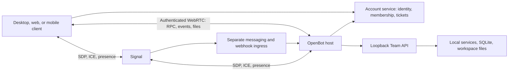

# OpenBot platform, tools, and remote access

Research date: 2026-10-22. Source: `nightly-labs/openbot`, commit `cfee2971f29cdb7c16272e60ae912de7fbb30693`. This report records source inspection. It does not certify a deployed service, a released binary, or an end-to-end production result. No app, provider turn, installer, or external mutation was run. Channel routing and agent-to-agent messaging have a separate report.

## Architecture and ownership

OpenBot is a host application with remote clients, rather than a cloud chat service with a local cache. `HostService` composes the local Team API with agents, mailbox, browser, files, skills, MCP, hosted sites, events, providers, and administration. The account service supplies remote host registration, membership, session tickets, and notification relays. The cloud control-plane schema stores hosts, public keys, hashed machine credentials, memberships, invitations, and logical sessions. The host remains the executor. [Host composition](https://github.com/nightly-labs/openbot/blob/cfee2971f29cdb7c16272e60ae912de7fbb30693/src/main/host-service.ts#L76-L163), [control-plane schema](https://github.com/nightly-labs/openbot/blob/cfee2971f29cdb7c16272e60ae912de7fbb30693/apps/auth-api/migrations/0012_remote_control_plane.sql#L1-L60).

“Local” means the computer running that host. It can be a user's desktop or a hosted computer. It does not mean that all features keep all content off cloud infrastructure. Hosted-site publication deliberately uploads files; the site-router Worker reads those files from R2. Messaging ingress also passes content through Signal. These are separate paths from the encrypted Team connection. [Site publisher](https://github.com/nightly-labs/openbot/blob/cfee2971f29cdb7c16272e60ae912de7fbb30693/src/main/hosted-site-service.ts#L63-L126), [R2 site routing](https://github.com/nightly-labs/openbot/blob/cfee2971f29cdb7c16272e60ae912de7fbb30693/apps/site-router/src/index.ts#L84-L167), [ingress forwarding](https://github.com/nightly-labs/openbot/blob/cfee2971f29cdb7c16272e60ae912de7fbb30693/remote/api/src/signal-service.ts#L767-L818).

### Remote connection path

The current shared client creates ordered DataChannels and uses v8 request/event adapters. Transport authentication still uses the released v2 authentication envelope. The host peer forwards authorized RPC to its loopback `/v1/` API, and separately tunnels restricted browser-view/remote-screen sockets. Thus transport version, application API version, and optional capability versions are distinct. [Client channel setup](https://github.com/nightly-labs/openbot/blob/cfee2971f29cdb7c16272e60ae912de7fbb30693/packages/team-client/src/remote-peer.ts#L930-L970), [client codecs](https://github.com/nightly-labs/openbot/blob/cfee2971f29cdb7c16272e60ae912de7fbb30693/packages/team-client/src/remote-peer.ts#L10-L31), [host RPC forwarding](https://github.com/nightly-labs/openbot/blob/cfee2971f29cdb7c16272e60ae912de7fbb30693/src/main/team-webrtc-host-peer.ts#L565-L600), [socket restriction](https://github.com/nightly-labs/openbot/blob/cfee2971f29cdb7c16272e60ae912de7fbb30693/src/main/team-webrtc-host-peer.ts#L929-L960).

Authentication is stronger than “has a Signal socket.” The host verifies the client ticket, matches its host/session/user/membership/role/public-key/expiry claims to the Signal connection, then verifies proof of possession over a transcript containing ticket, nonce, and both WebRTC certificate fingerprints. It returns a signed host challenge. The web client pins the validated host key and refuses a changed key. This binds application identity to the transport. It does not remove trust in the account service for membership decisions or first-use key discovery. [Host authentication](https://github.com/nightly-labs/openbot/blob/cfee2971f29cdb7c16272e60ae912de7fbb30693/src/main/team-webrtc-host-peer.ts#L370-L435), [web key pinning](https://github.com/nightly-labs/openbot/blob/cfee2971f29cdb7c16272e60ae912de7fbb30693/src/renderer/src/features/web-client/web-runtime.ts#L294-L344).

Each host gateway owns separate device peers. Session revocation is sent to every matching peer; disposing a transport is separate from revoking the logical session. This matters for reconnects and multiple devices. The hidden Chromium bridge uses Electron sandboxing, context isolation, and no Node integration. [Peer ownership and revocation](https://github.com/nightly-labs/openbot/blob/cfee2971f29cdb7c16272e60ae912de7fbb30693/src/main/team-webrtc-host-gateway.ts#L82-L111), [revocation](https://github.com/nightly-labs/openbot/blob/cfee2971f29cdb7c16272e60ae912de7fbb30693/src/main/team-webrtc-host-gateway.ts#L167-L170), [bridge isolation](https://github.com/nightly-labs/openbot/blob/cfee2971f29cdb7c16272e60ae912de7fbb30693/src/main/team-webrtc-bridge.ts#L215-L235).

The framing layer has explicit limits: 16 simultaneous assemblies, 8 MiB buffered assembly bytes, 30-second expiry, contiguous offsets, and a maximum protocol payload size. TURN credentials expire no later than the logical session and use the coturn HMAC credential format. These controls support bounded resource use; they do not establish tested throughput, network coverage, or uptime. [Framing](https://github.com/nightly-labs/openbot/blob/cfee2971f29cdb7c16272e60ae912de7fbb30693/packages/team-client/src/webrtc-framing.ts#L7-L108), [TURN issuance](https://github.com/nightly-labs/openbot/blob/cfee2971f29cdb7c16272e60ae912de7fbb30693/remote/api/src/tokens.ts#L444-L460).

### Compatibility is a first-class cost

The host advertises protocols 1 through 8, preserves the old adapters, and composes optional capabilities for new routes. Compatibility discovery is outside the protocol gate so an incompatible client can receive update guidance. Unsupported data can be hidden from a client whose frozen codec cannot represent it. This is a useful pattern for independently released mobile clients, but it creates permanent adapter and fixture maintenance work. [Adapters](https://github.com/nightly-labs/openbot/blob/cfee2971f29cdb7c16272e60ae912de7fbb30693/packages/contracts/src/team-protocol/index.ts#L1-L24), [capability catalog](https://github.com/nightly-labs/openbot/blob/cfee2971f29cdb7c16272e60ae912de7fbb30693/packages/contracts/src/team-protocol/current.ts#L1-L107), [compatibility gate](https://github.com/nightly-labs/openbot/blob/cfee2971f29cdb7c16272e60ae912de7fbb30693/src/main/team-api-server.ts#L663-L682), [protocol support and rejection](https://github.com/nightly-labs/openbot/blob/cfee2971f29cdb7c16272e60ae912de7fbb30693/src/main/team-api-server.ts#L1837-L1948).

## Desktop, web, and mobile

Desktop runs the privileged services behind the preload boundary. The normal window enables sandbox and context isolation, disables Node integration, denies new windows, and constrains navigation. Remote administration still reaches the host's domain operations; frontend controls alone are not the security boundary. [Main-window settings](https://github.com/nightly-labs/openbot/blob/cfee2971f29cdb7c16272e60ae912de7fbb30693/src/main/main-window.ts#L160-L210), [navigation control](https://github.com/nightly-labs/openbot/blob/cfee2971f29cdb7c16272e60ae912de7fbb30693/src/main/main-window.ts#L300-L320).

The web client uses the shared SolidJS application controls and an explicit web runtime. Its source lives under the renderer's `features/web-client`, even though the account website serves `/app`. Its directory adapter uses browser authentication on the same origin. Account credentials use a Secure, HttpOnly, SameSite=Lax cookie, and writes require an exact Origin and `X-OpenBot-Browser: 1`. Browser-held host keys are separate from the cookie. [Web runtime](https://github.com/nightly-labs/openbot/blob/cfee2971f29cdb7c16272e60ae912de7fbb30693/src/renderer/src/features/web-client/web-runtime.ts#L309-L344), [browser account boundary](https://github.com/nightly-labs/openbot/blob/cfee2971f29cdb7c16272e60ae912de7fbb30693/apps/auth-api/src/server/browser-api.ts#L25-L35), [write checks](https://github.com/nightly-labs/openbot/blob/cfee2971f29cdb7c16272e60ae912de7fbb30693/apps/auth-api/src/server/browser-api.ts#L130-L170).

Mobile uses React Native/Expo UI and a DOM component that instantiates the shared `createRemoteTeamPeer`. The bridge exchanges commands by IDs, cancels pending callers on replacement, and shares file-transfer and protocol codecs. This is actual client code, not a screenshot of the desktop. Platform lifecycle, native sharing, permission behavior, and recovery still need device qualification. [Mobile bridge](https://github.com/nightly-labs/openbot/blob/cfee2971f29cdb7c16272e60ae912de7fbb30693/apps/mobile/src/features/workspace/components/remote-team-bridge.dom.tsx#L1-L70), [shared command mailbox](https://github.com/nightly-labs/openbot/blob/cfee2971f29cdb7c16272e60ae912de7fbb30693/packages/team-client/src/remote-peer.ts#L78-L141).

## Tools, MCP, skills, and plugins

OpenBot owns a tool router that delegates provider-originated calls to domain controllers: attention, browser, attachments, messaging, hosted sites, routines, data, memory, skills, tasks, and waits. A tool catalog exposes search, describe, and call operations so a provider can discover tool schemas on demand. The product is therefore more than an MCP launcher, while MCP remains its principal external tool boundary. [Router ownership](https://github.com/nightly-labs/openbot/blob/cfee2971f29cdb7c16272e60ae912de7fbb30693/src/backend/agent/openbot-tool-router.ts#L151-L188), [catalog](https://github.com/nightly-labs/openbot/blob/cfee2971f29cdb7c16272e60ae912de7fbb30693/src/backend/agent/tool-catalog.ts#L42-L78).

MCP configurations are machine-wide. The gateway owns configured entries, computer-use injection, GitHub integration, credential handoff tracking, and redaction. Provider processes generally own the actual MCP connections. For signed-in HTTP servers, the provider gets a loopback proxy URL and route bearer; the OAuth token stays in the host process. Proxy startup failure does not fall back to exposing the raw token. [Gateway](https://github.com/nightly-labs/openbot/blob/cfee2971f29cdb7c16272e60ae912de7fbb30693/src/backend/agent/mcp-gateway.ts#L82-L117), [OAuth proxy handoff](https://github.com/nightly-labs/openbot/blob/cfee2971f29cdb7c16272e60ae912de7fbb30693/src/backend/agent/mcp-gateway.ts#L147-L173), [connection ownership](https://github.com/nightly-labs/openbot/blob/cfee2971f29cdb7c16272e60ae912de7fbb30693/src/backend/agent/mcp-gateway.ts#L241-L248).

There are two different credential surfaces. Agent MCP-management tools show key names, never header/environment values, and protect credential-bearing configurations against endpoint changes. Remote Team MCP administration deliberately returns the complete configuration, including values, to owners/admins. It can test a supplied stdio command on the host. Thus an administrator is a highly trusted machine operator, not merely a chat moderator. [Agent management](https://github.com/nightly-labs/openbot/blob/cfee2971f29cdb7c16272e60ae912de7fbb30693/src/backend/agent/mcp-tools.ts#L18-L85), [approval and endpoint checks](https://github.com/nightly-labs/openbot/blob/cfee2971f29cdb7c16272e60ae912de7fbb30693/src/backend/agent/mcp-tools.ts#L174-L216), [remote admin contract](https://github.com/nightly-labs/openbot/blob/cfee2971f29cdb7c16272e60ae912de7fbb30693/src/main/team-api/route-mcp.ts#L17-L67).

Skills are files with `SKILL.md` metadata. OpenBot installs managed copies into both `.agents/skills` and `.claude/skills`. Archive validation limits files and expanded size, rejects path escape and certain secret/archive names, and reads YAML metadata. Local library revisions use immutable versioned bundles, hashes, serialized writes, and expected-revision checks. These are packaging and integrity controls, not proof that instructions or executable content are safe. [Managed paths](https://github.com/nightly-labs/openbot/blob/cfee2971f29cdb7c16272e60ae912de7fbb30693/src/main/managed-skill-service.ts#L20-L30), [package validation](https://github.com/nightly-labs/openbot/blob/cfee2971f29cdb7c16272e60ae912de7fbb30693/src/main/skill-package.ts#L11-L115), [local revisions](https://github.com/nightly-labs/openbot/blob/cfee2971f29cdb7c16272e60ae912de7fbb30693/src/main/local-skill-library.ts#L57-L125).

A plugin combines catalog metadata, MCP apps, and optional pinned skills. Installation puts skills into a selected agent and MCP configurations on the host. It installs skills first and attempts to remove newly added skills if a later step fails. The installer does not implement a single transaction across all apps and skills; its shown rollback targets skills. Deep links only open a listing; they do not install software. [Install orchestration](https://github.com/nightly-labs/openbot/blob/cfee2971f29cdb7c16272e60ae912de7fbb30693/src/renderer/src/features/settings/marketplace-controller.ts#L550-L619), [deep-link boundary](https://github.com/nightly-labs/openbot/blob/cfee2971f29cdb7c16272e60ae912de7fbb30693/src/main/ipc/plugin-handlers.ts#L8-L20).

At this commit, the desktop catalog is generated TypeScript from repository catalog files, and the tool router imports a bundled JSON catalog. Do not infer that the planned remote catalog/cache/update design is all active. The architecture document itself mixes implemented parts and future design in its distribution section. [Generated catalog](https://github.com/nightly-labs/openbot/blob/cfee2971f29cdb7c16272e60ae912de7fbb30693/src/renderer/src/features/settings/marketplace-plugin-catalog.ts#L1-L37), [bundled catalog consumer](https://github.com/nightly-labs/openbot/blob/cfee2971f29cdb7c16272e60ae912de7fbb30693/src/backend/agent/openbot-tool-router.ts#L29-L38).

Built-in connectors are distinct from ordinary catalog apps. The 1Password integration uses a dedicated shared vault and a read-items service-account grant; Bitwarden uses a memory-only CLI session and an application-enforced folder restriction. Bitwarden calls use fixed executable invocation, an allowlisted environment, a 30-second deadline, and output limits. Its eight-hour idle expiry and current-item rechecks reduce stale access. They do not limit the actions an agent can perform after it signs in to an allowed site. [1Password setup](https://github.com/nightly-labs/openbot/blob/cfee2971f29cdb7c16272e60ae912de7fbb30693/src/main/onepassword-connector-service.ts#L620-L655), [Bitwarden execution and matching](https://github.com/nightly-labs/openbot/blob/cfee2971f29cdb7c16272e60ae912de7fbb30693/src/main/bitwarden-connector-service.ts#L58-L126), [session and item revalidation](https://github.com/nightly-labs/openbot/blob/cfee2971f29cdb7c16272e60ae912de7fbb30693/src/main/bitwarden-connector-service.ts#L155-L238).

GitHub has its own device sign-in, refresh, MCP proxy, and `git`/`gh` credential files. It can ask the account Worker for GitHub App installation tokens limited to repositories where the user can push; `gh` retains user-token identity. Unlike the generic OAuth proxy above, the GitHub connector explicitly permits a direct user-token fallback if its proxy did not start. This is another reason to document credential behavior per connector rather than claim that every integration keeps tokens behind the same boundary. [GitHub ownership and identity](https://github.com/nightly-labs/openbot/blob/cfee2971f29cdb7c16272e60ae912de7fbb30693/src/main/github-connector-service.ts#L92-L104), [proxy fallback](https://github.com/nightly-labs/openbot/blob/cfee2971f29cdb7c16272e60ae912de7fbb30693/src/main/github-connector-service.ts#L135-L142), [installation token scope](https://github.com/nightly-labs/openbot/blob/cfee2971f29cdb7c16272e60ae912de7fbb30693/apps/auth-api/src/server/github-installation-tokens.ts#L5-L13).

## Browser and computer use

The built-in browser exposes semantic snapshots, navigation, clicks, typing, batch field fill, selection, uploads, waits, JavaScript evaluation, environment changes, recording, screenshots, and explicit tab closure. Each tab is bound to a thread and agent. The lowest tab gate refuses another owner, a user-held tab, a takeover, and protected authentication. A per-tab queue serializes operations. [Tool surface](https://github.com/nightly-labs/openbot/blob/cfee2971f29cdb7c16272e60ae912de7fbb30693/src/backend/browser-tools.ts#L88-L345), [ownership and queue](https://github.com/nightly-labs/openbot/blob/cfee2971f29cdb7c16272e60ae912de7fbb30693/src/backend/browser-host.ts#L2571-L2599).

Secure secret entry is a separate route. It requires HTTPS, resolves fields, marks the tab protected, invalidates viewers, discards recording, clears diagnostics, and checks connected pages again before entry. It records whether the agent has already evaluated script on the origin. After submission it waits for document replacement or clears and checks the fields, with a GET reload fallback. This is a concrete attempt to keep passwords out of screenshots, tool output, and provider arguments; it is not a universal guarantee against arbitrary hostile sites. [Preparation and entry](https://github.com/nightly-labs/openbot/blob/cfee2971f29cdb7c16272e60ae912de7fbb30693/src/backend/browser-host.ts#L1020-L1103), [cleanup](https://github.com/nightly-labs/openbot/blob/cfee2971f29cdb7c16272e60ae912de7fbb30693/src/backend/browser-host.ts#L1104-L1145).

Desktop-wide computer use is a separate `cua-driver` daemon. Each provider receives a stdio MCP proxy to its socket only when permission state is ready. The runtime directly spawns the daemon with embedded mode and its own overlay ownership. Unix sockets live in a checked private directory. This capability can operate the entire desktop; browser tab ownership does not constrain it. [Provider configuration](https://github.com/nightly-labs/openbot/blob/cfee2971f29cdb7c16272e60ae912de7fbb30693/src/main/cua-driver-runtime.ts#L375-L406), [daemon launch and socket boundary](https://github.com/nightly-labs/openbot/blob/cfee2971f29cdb7c16272e60ae912de7fbb30693/src/main/cua-driver-runtime.ts#L535-L575).

Remote desktop uses a distinct Sunshine/Moonlight runtime behind `RemoteScreenGateway`; browser viewing uses a tab stream. Host composition passes setup, display, ICE, clipboard, and credential dependencies explicitly. These are separate from agent computer-use MCP. They need distinct permission and lifecycle tests. [Runtime dependencies](https://github.com/nightly-labs/openbot/blob/cfee2971f29cdb7c16272e60ae912de7fbb30693/src/main/host-service.ts#L129-L144), [allowed stream tunnel](https://github.com/nightly-labs/openbot/blob/cfee2971f29cdb7c16272e60ae912de7fbb30693/src/main/team-webrtc-host-peer.ts#L929-L960).

## Files, shared data, and hosted sites

The Team API supports attachment upload/delete/download and shared/workspace file download. It validates attachment basenames and lengths, applies upload slots and byte limits, resolves server-side paths, and streams downloads from an opened file with a rechecked size. This is host file access through an authenticated application protocol, not a cloud file-sync product. [File routes](https://github.com/nightly-labs/openbot/blob/cfee2971f29cdb7c16272e60ae912de7fbb30693/src/main/team-api/route-files.ts#L88-L168), [stream ownership](https://github.com/nightly-labs/openbot/blob/cfee2971f29cdb7c16272e60ae912de7fbb30693/src/main/team-api/route-files.ts#L174-L210).

Agents share one structured-data database through list/query/execute/delete-table tools. All agents can change rows; only the creating agent may alter/drop its table. SQLite's authorizer enforces restrictions, including attach and dangerous metadata operations. A separate killable database host and supervisor impose real statement deadlines. Current limits include 500 returned rows, 256 KB result bytes, 2,000 characters per cell, a five-second statement deadline, and a roughly 256 MB whole-store ceiling. This is collaborative shared storage, not per-agent data isolation. [Tool contract](https://github.com/nightly-labs/openbot/blob/cfee2971f29cdb7c16272e60ae912de7fbb30693/src/backend/agent/data-tools.ts#L16-L39), [SQLite authorizer](https://github.com/nightly-labs/openbot/blob/cfee2971f29cdb7c16272e60ae912de7fbb30693/src/backend/agent-data/agent-database-host.ts#L70-L110), [supervisor](https://github.com/nightly-labs/openbot/blob/cfee2971f29cdb7c16272e60ae912de7fbb30693/src/backend/agent-data/agent-database-supervisor.ts#L37-L48), [limits](https://github.com/nightly-labs/openbot/blob/cfee2971f29cdb7c16272e60ae912de7fbb30693/src/backend/agent-data/agent-database-protocol.ts#L86-L103).

Remote shared-table administration exposes list/delete metadata operations to admins; it does not expose arbitrary row queries through that capability. Hosted-site administration is also server-scoped: joined members do not see an owner's unrelated unlinked sites. The router serves static assets with route state, expiry, and block checks before cache access. Treat it as static-site publication, not evidence of an arbitrary application backend hosting platform. [Shared-table route](https://github.com/nightly-labs/openbot/blob/cfee2971f29cdb7c16272e60ae912de7fbb30693/src/main/team-api/route-shared-tables.ts#L10-L36), [site scope](https://github.com/nightly-labs/openbot/blob/cfee2971f29cdb7c16272e60ae912de7fbb30693/src/main/hosted-site-service.ts#L145-L168), [site serving](https://github.com/nightly-labs/openbot/blob/cfee2971f29cdb7c16272e60ae912de7fbb30693/apps/site-router/src/index.ts#L84-L167).

## Scheduled and event-driven work

Routines are persistent agent instructions with run records and mailbox delivery, not just timer callbacks. Schedule input supports hourly/daily/weekly/monthly, anchored intervals, custom cron, advanced calendar selections, and one-time runs. Usage-limit policy and missed-run policy are explicit. The schema describes recurring defaults as skipping missed occurrences and one-time defaults as running once on return. [Schedule and policy schema](https://github.com/nightly-labs/openbot/blob/cfee2971f29cdb7c16272e60ae912de7fbb30693/src/backend/routine-tool-schema.ts#L25-L75), [scheduler dependencies and ownership](https://github.com/nightly-labs/openbot/blob/cfee2971f29cdb7c16272e60ae912de7fbb30693/src/backend/agent/routine-scheduler.ts#L108-L184).

One `RoutineTimer` derives the earliest due time across all routine owners. It pauses on system sleep and explicit hold, prevents overlapping firing passes, then re-reads due state after the pass. The host must run for its local scheduler to execute; missed-run handling is not an uptime guarantee. Routine flows add links that send one agent's answer to another, with changes applying to later runs. [Timer](https://github.com/nightly-labs/openbot/blob/cfee2971f29cdb7c16272e60ae912de7fbb30693/src/backend/routine-timer.ts#L21-L131), [flow tools](https://github.com/nightly-labs/openbot/blob/cfee2971f29cdb7c16272e60ae912de7fbb30693/src/backend/routine-flows/routine-flow-tools.ts#L29-L48).

Generic webhooks have a separate trust path: account-owned route metadata, a Signal ingress lease, an encrypted local signing secret, HMAC-SHA256 over exact `timestamp.deliveryId.body` bytes, freshness checks, and route/routine delivery deduplication. The host acknowledges started/ignored events with 202 and duplicates with 200. Signal's generic webhook delivery returns unavailable when it lacks an active ingress path or acknowledgement; callers must retry. Do not describe this as a durable cloud queue. [Route ownership](https://github.com/nightly-labs/openbot/blob/cfee2971f29cdb7c16272e60ae912de7fbb30693/src/main/webhook-relay.ts#L27-L84), [signature validation](https://github.com/nightly-labs/openbot/blob/cfee2971f29cdb7c16272e60ae912de7fbb30693/src/main/webhook-security.ts#L30-L67), [host acceptance](https://github.com/nightly-labs/openbot/blob/cfee2971f29cdb7c16272e60ae912de7fbb30693/src/main/host-events-service.ts#L199-L247), [Signal delivery](https://github.com/nightly-labs/openbot/blob/cfee2971f29cdb7c16272e60ae912de7fbb30693/remote/api/src/signal-service.ts#L767-L818).

Messaging wake queues are a different mechanism. Signal can ask the account service to wake a hosted server and retain an event sealed to that host until acknowledgement. The queue is in memory and loses contents on Signal restart. Defaults are ten-minute TTL, 64 messages and 192 KiB per host, and 256 MiB total. This corrects the overly broad claim that Signal only handles SDP/ICE, while preserving the distinction between transient ingress and chat persistence. [Queue implementation and limits](https://github.com/nightly-labs/openbot/blob/cfee2971f29cdb7c16272e60ae912de7fbb30693/remote/api/src/ingress-queue.ts#L9-L58).

## Evidence and qualification

Source coverage is substantial, but tests were inspected, not executed. The repository has targeted scripts for Team routes, legacy-client compatibility, session revocation, Signal security, MCP OAuth/consent/management, browser smoke, routines, webhook routines, and remote desktop. Test availability does not prove that the pinned checkout passes, that CI ran it, or that physical devices and production services pass. [Registered scripts](https://github.com/nightly-labs/openbot/blob/cfee2971f29cdb7c16272e60ae912de7fbb30693/package.json#L192-L263).

The legacy-client script exercises the real host API with released-shape assertions and writes a JSON report. The Signal security script covers invalid signatures, inactive/uncheckable sessions, ingress tickets, missing hello deadlines, TURN reuse, and secret leakage. MCP management tests drive actual gateway/store/probe modules against loopback servers without a provider account. Browser secret smoke uses an isolated HTTPS fixture and checks blocked snapshot/evaluation and post-submit secret absence. These tests cover distinct boundaries; none alone establishes the full production path. [Legacy protocol checks](https://github.com/nightly-labs/openbot/blob/cfee2971f29cdb7c16272e60ae912de7fbb30693/scripts/team-api-legacy-clients-e2e.ts#L364-L427), [Signal checks](https://github.com/nightly-labs/openbot/blob/cfee2971f29cdb7c16272e60ae912de7fbb30693/scripts/signal-security-e2e.ts#L585-L698), [MCP fixture scope](https://github.com/nightly-labs/openbot/blob/cfee2971f29cdb7c16272e60ae912de7fbb30693/scripts/agent-mcp-tools-e2e.ts#L1-L18), [browser secret fixture](https://github.com/nightly-labs/openbot/blob/cfee2971f29cdb7c16272e60ae912de7fbb30693/scripts/browser-secret-smoke.ts#L76-L100).

## Design implications for Cubebot

These are deductions from the inspected implementation, not claims about Cubebot requirements.

| Decision | Useful OpenBot pattern | Cost or boundary to decide explicitly |
| --- | --- | --- |
| Local ownership | Keep execution and authoritative work data on a host; use a separate account directory. | Hosted publication, providers, telemetry, and messaging have their own outbound data paths. |
| Remote access | Authenticate the application session and bind it to the encrypted transport. | First-use identity, revocation, offline behavior, TURN operation, and reconnects need separate designs. |
| API evolution | Freeze released adapters; add capability versions. | Mobile release independence creates long-term compatibility work. |
| Tool access | Route built-in tools to narrow domain owners; give MCP credentials through a local proxy. | Host-wide MCP and admin stdio execution are powerful shared grants. |
| Skills and plugins | Validate bundles, pin revisions, track installed files, require deliberate installation. | File integrity is not semantic trust; multi-part installation needs explicit rollback semantics. |
| Browser automation | Own tabs, serialize actions, support user takeover, separate secret entry. | Desktop-wide computer use has a much wider permission boundary. |
| Shared data | Bound SQL through an authorizer and killable process. | Shared rows allow cross-agent writes; table ownership is not row isolation. |
| Automation | Persist runs/deliveries and model missed/limited/paused states. | Local timers and transient relay queues do not provide durable cloud workflow guarantees. |
| Verification | Produce repeatable boundary-focused E2E artifacts. | Source inspection, test code, local results, and deployed acceptance are different evidence levels. |
